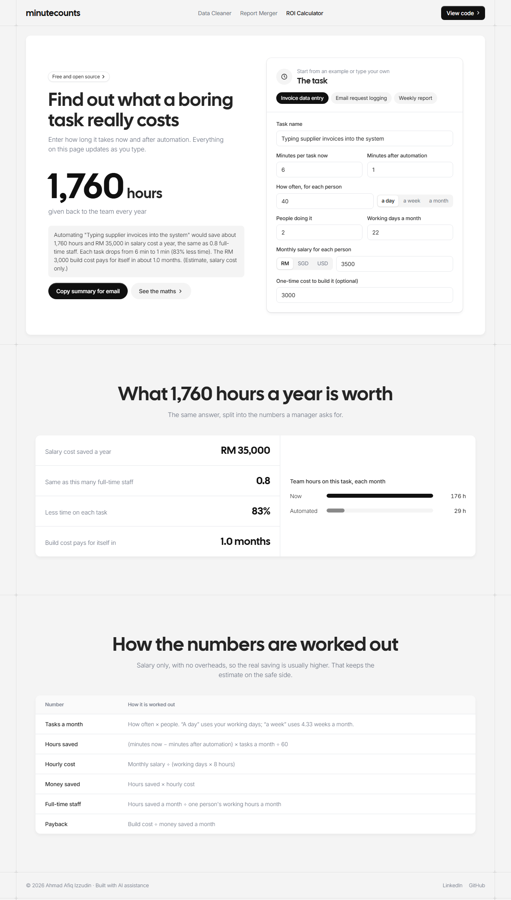

# Automation ROI Calculator

Is this task worth automating? See the hours and money a team gets back every year, in under a minute.

**[Open the live tool](https://afiqizzudinnn.github.io/automation-roi-calculator/)**



## The problem

Everyone knows some tasks are slow and repetitive. But "this is boring" does not get an automation project approved. Management wants numbers: how many hours, how much money, and how fast the build cost pays back.

Most people do not have a quick, clear way to put those numbers together.

## What it does

Enter 7 simple inputs about one task:

- minutes per task today, and after automation
- how often it happens, and how many people do it
- monthly salary and working days
- the one-time build cost (optional)

And get back, instantly:

- **hours saved per year**
- **salary cost saved per year** (RM, SGD or USD)
- **full-time staff freed up**
- **percentage of time saved per task**
- **payback period** for the build cost
- a **one-paragraph summary** you can copy straight into an email to your manager

3 presets (invoice data entry, email request logging, weekly report) show how it works in one click.

## The maths, in plain words

| Number | Formula |
|---|---|
| Tasks per month | how often × people (per week uses 4.33 weeks a month) |
| Hours saved | (minutes today − minutes after) × tasks per month ÷ 60 |
| Hourly cost | monthly salary ÷ (working days × 8 hours) |
| Money saved | hours saved × hourly cost |
| Staff freed up | hours saved per month ÷ one person's working hours per month |
| Payback period | build cost ÷ money saved per month |

It counts salary only, with no overheads, so the real saving is usually higher. That keeps the estimate on the safe side.

## Example

Typing supplier invoices into the system: 6 minutes each by hand, 1 minute once automated, 40 a day, 2 staff on RM 3,500 a month.

Result: about **1,760 hours** and **RM 35,000** saved a year, the same as 0.8 of a full-time staff. A RM 3,000 build pays back in about a month.

## How it is built

No framework, no libraries, no build step and no server. Plain HTML, CSS and JavaScript modules, and nothing you type leaves your browser. The maths is a pure function, kept apart from the page code.

```
index.html              page markup
css/theme.css           design system shared by the Office Toolkit
css/roi.css             styles only this tool uses
js/page-transition.js   slide between the toolkit pages
js/roi.js               the ROI maths
js/presets.js           the example tasks
js/main.js              page code: inputs, results, copy
```
## Run it locally

The scripts are JavaScript modules, so serve the folder with any local web server instead of double-clicking `index.html`:

```bash
python -m http.server 8000
```

Then open http://localhost:8000. Internet is needed once to load the fonts.


## About

Built by **Ahmad Afiq Izzudin**, Business Process & Automation Analyst. I designed the business case model, and used AI assistance to write the code faster. It reflects how I like to pitch automation: start with the time saved, then turn it into money.

[LinkedIn](https://www.linkedin.com/in/afiq-izzudin-27aaa936b) · Part of my Office Toolkit, together with the [Excel Data Cleaner](https://github.com/Afiqizzudinnn/excel-data-cleaner) and the [Excel Report Merger](https://github.com/Afiqizzudinnn/excel-report-merger).

Licensed under MIT.
